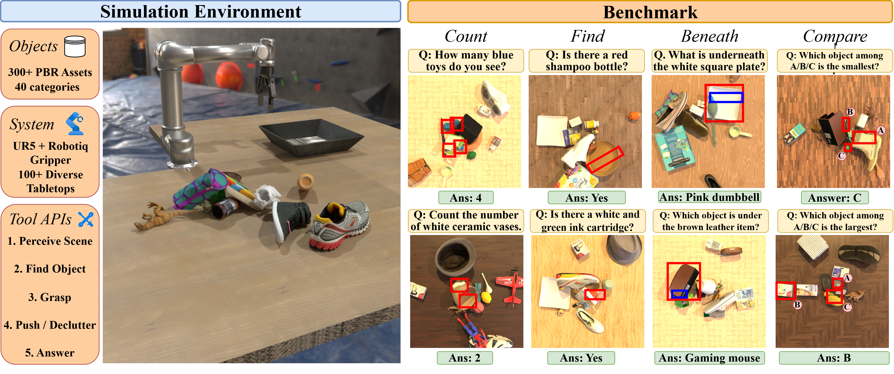

# MG-VQA: Manipulation Grounded Visual Question Answering with VLMs



## Overview

This repository implements **MG-VQA-Sim**, a simulation environment for
manipulation-grounded embodied spatial reasoning. A central VLM planner uses
perception and manipulation tools to interact with a cluttered tabletop scene
and answer questions.

**MG-VQA-Bench** contains 600 frozen questions across **Count, Find, Beneath,
and Compare**, evaluated under three tool-access modes:

| Mode | Planner access |
|---|---|
| `direct` | A single RGB image; no tools |
| `perception` | Scene graph and point-based segmentation |
| `agentic` (Manipulation) | Perception plus UR5 grasping and pushing to reveal evidence |

## Getting started

### 1. Environment and dependencies

Linux, an NVIDIA GPU/driver, and conda are required. Install
[Blender 5.1](https://www.blender.org/download/) and put `blender` on PATH (or set
`BLENDER=/path/to/blender`). Agentic mode also requires a matching CUDA toolkit
with `nvcc`; see [INSTALL.md](INSTALL.md) for GPU/compiler choices.

```bash
conda env create -f environment.yml       # optional: -n YOUR_ENV
conda activate mg-vqa
bash scripts/finish_setup.sh             # --cuda auto|11.8|12.1|12.8
bash scripts/download_weights.sh         # SAM3 + GraspGen; accept upstream terms
python scripts/download_assets.py
```

### 2. API credentials

Copy `.env.example` to **`.env` in the repository root** and edit it:

```bash
cp .env.example .env
```

```dotenv
NV_API_KEY=your_gateway_key_here
# Optional Blender path:
# BLENDER=/path/to/blender
# Optional, only for a different gateway endpoint:
# NVIDIA_API_BASE_URL=https://inference-api.nvidia.com/v1
```

All catalog planners and the default scene-graph model use this NVIDIA gateway
key (`NVIDIA_API_KEY` is also accepted). The key must have access to the specified
models at this endpoint; a generic NVIDIA key may not have those entitlements.
Both launchers load the root `.env` automatically. Alternatively, supply keys as
environment variables and leave `.env` absent. Python preserves existing
environment variables; the shell wrapper sources `.env`, overriding matching
shell variables.

For native providers, use `OPENAI_API_KEY`, `GEMINI_API_KEY`/`GOOGLE_API_KEY`, or
`ANTHROPIC_API_KEY` with the model routes in [models.md](models.md).
Perception/agentic still requires the gateway key for the default scene model
unless you explicitly choose a native `--scene-model` too.

### 3. Benchmark data and shared assets

The benchmark contains frozen scene poses, questions/annotations, and
scene-specific rendering data (such as Compare badge textures and saved table
textures). **Object meshes, object textures and URDFs are downloaded separately**
by `python scripts/download_assets.py` from
[`vineet-datasets/agentic-mqa-objects`](https://huggingface.co/datasets/vineet-datasets/agentic-mqa-objects).
The evaluation asset pool is downloaded once and reused across episodes; the
training pool is not needed. SAM3/GraspGen weights are fetched separately by
`bash scripts/download_weights.sh`. Robot/scene assets are included in the source
tree. Even Direct mode needs the shared object assets to render restored scenes.
See [Licensing](#licensing) before using or redistributing these components.

Download **[mg-vqa-bench](https://huggingface.co/datasets/bhatvineet/mg-vqa-bench)**:

```bash
python scripts/download_benchmark.py
DATASET=approved-questions/mg-vqa-bench
python scripts/preflight.py --mode agentic --snapshot "$DATASET"
```

The downloader pins revision `78c4d8adf7a5c68060bc32b340c8a746933f659c`.
Use `--output /path/to/mg-vqa-bench` for a different location and set `DATASET`
accordingly. Keep the episode directories and shared texture store together.

## Evaluation

### Run a model

Use the active Python environment. Run from the repository root, or invoke the
shell wrapper by its path. Model IDs and provider keys are in [models.md](models.md).
All episodes in `--dataset` are discovered automatically; no episode selection
is needed.

```bash
# Manipulation: complete dataset, chosen model, four workers
./run_mgvqa.sh --dataset "$DATASET" --model azure/openai/gpt-6-astra --mode agentic --workers 4

# Perception only, or direct (one image, no tools)
./run_mgvqa.sh --dataset "$DATASET" --model gcp/google/gemini-3.1-pro-preview --mode perception --workers 4
./run_mgvqa.sh --dataset "$DATASET" --model gcp/google/gemini-3.8-flash --mode direct --workers 4

# All three modes, each on the complete dataset
./run_mgvqa.sh --dataset "$DATASET" --mode direct,perception,agentic --workers 4

# Equivalent Python interface (one mode per invocation)
python -m mgvqa --dataset "$DATASET" --model azure/openai/gpt-6-astra --mode agentic --workers 4

# Inspect the command without loading models, calling APIs, or executing scenes
./run_mgvqa.sh --dataset "$DATASET" --mode agentic --workers 4 --dry-run
```

### Parallelism and configuration

On the reference RTX 5090 (32 GB VRAM, ~62 GB RAM), **4 workers with recycling
every 4 episodes** is the recommended configuration. `--workers`, `--gpus`, and
`--recycle` control parallelism; `--snapshot` is an alias for `--dataset`.
See `./run_mgvqa.sh --help` for options.

### Results and reports

Each experiment gets its own gitignored directory:
`rollouts/<model>_<mode>_<YYYYMMDD_HHMMSS>/`, for example
`rollouts/azure-openai-gpt-6-astra_agentic_20260927_183045/`.
Model-ID slashes become hyphens; simultaneous runs get a numeric suffix rather
than sharing results.

Accuracy is **correct / answered**, overall and per task. Non-answer failures
are excluded and listed separately. Results, configuration, and per-turn
image/prompt traces are saved with the experiment. Build an HTML report with:

```bash
python scripts/build_report.py RUN_DIRECTORY
```

## Code guide

### Directory structure and core scripts

```text
run_mgvqa.sh                  # Shell launcher; supports multiple modes
mgvqa/
  __main__.py                 # Public Python CLI: python -m mgvqa
  run_benchmark.py            # Frozen-bank replay entry point
  worker.py                   # Episode lifecycle and answer scoring
  orchestrator/               # Parallel workers, recycling, merged summaries
  reasoning_loop.py          # Perception/agentic tool loop and image history
  singlepass.py              # Direct-mode inference
  prompt_templates/          # Three system prompts and three user templates
  prompts.py                 # Fill templates and format anonymous tool feedback
  tool_registry.py           # Tool names, aliases, mode restrictions, dispatch
  scene_snapshot.py          # Restore frozen scenes and rendering metadata
  metrics.py                 # Shared answer-only accuracy calculations
models/                      # Model catalog, API routing and protocol adapters
perception/                  # Scene graph, point grounding, SAM utilities
manipulation/                # Grasp and push implementations
owg_robot/                   # PyBullet environment, UR5, camera and robot assets
robo_blender/                # Blender rendering and scene synchronization
experiments/marked_size/     # Compare-task badges and replay support
scene_gen/                   # Shared question-phrasing helpers
config/                      # Simulator/camera configuration
scripts/
  finish_setup.sh            # GPU-specific dependency installation
  download_weights.sh        # SAM3 and GraspGen weights
  download_assets.py         # Object meshes and table textures
  download_benchmark.py      # Download a pinned, root-layout benchmark bank
  preflight.py               # Local dependency, GPU, weight and bank checks
  check_models.py            # Small paid model-access/image checks
  build_report.py            # HTML rollout report
  export_release.py          # Export source without history or research files
questions.py                 # Task definitions and ground-truth helpers
tools.py                     # Shared utilities and compatibility exports
tests/                       # CLI, prompt, protocol and metrics regression tests
rollouts/                    # Generated experiments (gitignored)
```

To adjust planner instructions, edit [`mgvqa/prompt_templates/`](mgvqa/prompt_templates/README.md).
To add models, see [models.md](models.md); for tool lifecycle and simulator
boundaries, see [ARCHITECTURE.md](ARCHITECTURE.md). Run local regression tests with
`python -m pytest tests -q`.

## Licensing

Original MG-VQA code and documentation are released under the **[MIT License](LICENSE)**
for commercial and non-commercial use. Third-party code, assets and model weights
retain their respective upstream licenses and are not covered by our MIT license.

Our simulation tasks use **319 objects** from the following sources. Refer to the
linked upstream pages for their licenses and terms of use.

| Object source | Objects | Source and terms |
|---|---:|---|
| Meta Digital Twin Catalog (DTC) | 136 | [Repository](https://github.com/facebookresearch/DigitalTwinCatalog) · [Terms](https://www.projectaria.com/datasets/dtc/license/) |
| MegaPose-sourced object models | 155 | [Data sources](https://github.com/megapose6d/megapose6d#dataset) |
| BOP: HB, HANDAL, HOPE, YCB-V, XYZ-IBD, ITODD and LM-O | 28 | [Datasets and terms](https://bop.felk.cvut.cz/datasets/) |

Other upstream components include [ambientCG textures](https://docs.ambientcg.com/license/),
[GraspGen](https://github.com/NVlabs/GraspGen/blob/main/LICENSE),
[SAM3](third_party/sam3/LICENSE), and [Ultralytics](https://www.ultralytics.com/license).

## Next updates

Planned extensions (not included in the current release):

- [ ] Release **MG-VQA-HARD**, the harder benchmark collection.
- [ ] Extend the environment with additional manipulation tools.
- [ ] Release a training-data creation engine for generating scenes and agent trajectories.

## Citation

```bibtex
@misc{bhat2026mgvqamanipulationgroundedvisual,
      title={MG-VQA: Manipulation Grounded Visual Question Answering with VLMs}, 
      author={Vineet Bhat and Mikaela Angelina Uy and Siyi Chen and Chan Hee Song and Alex Zook and Xuning Yang and Stan Birchfield and Valts Blukis and Jonathan Tremblay},
      year={2026},
      eprint={2608.17129},
      archivePrefix={arXiv},
      primaryClass={cs.CV},
      url={https://arxiv.org/abs/2608.17129}, 
}
```
